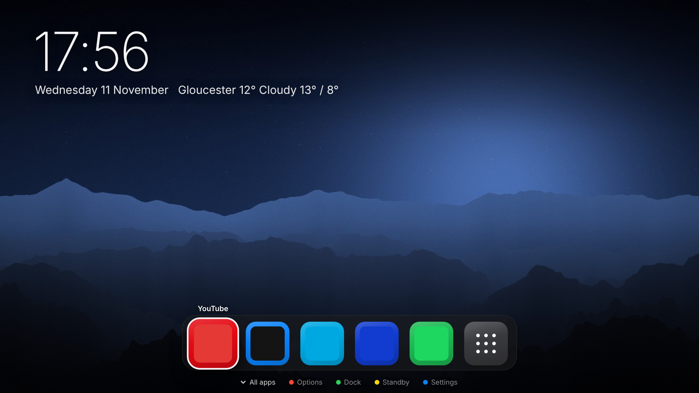
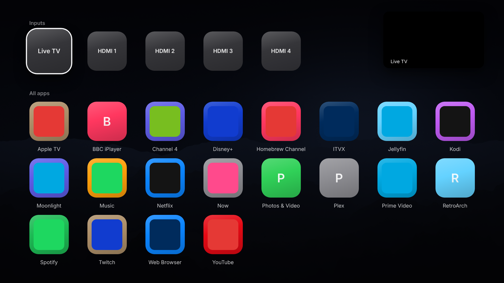
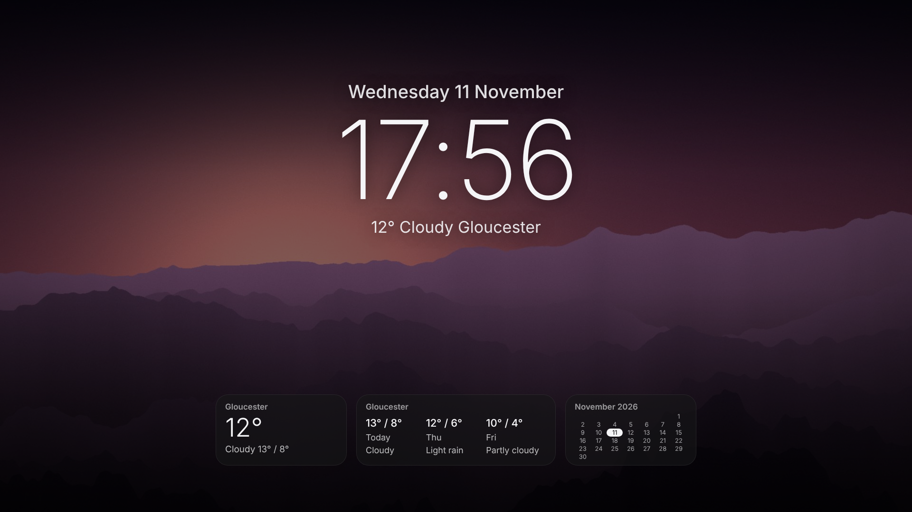
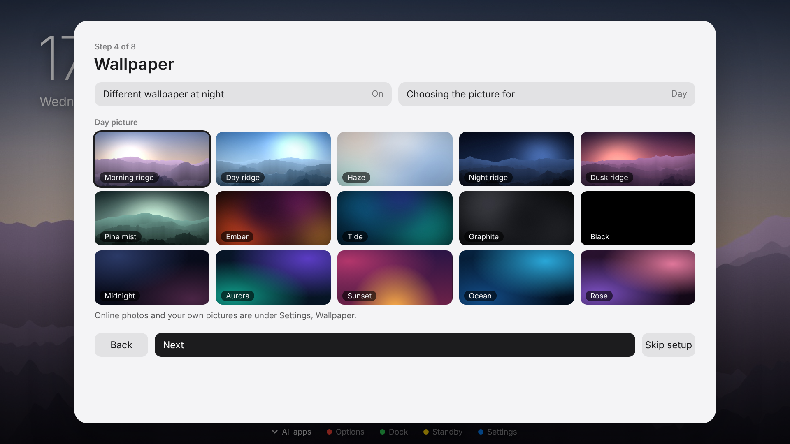
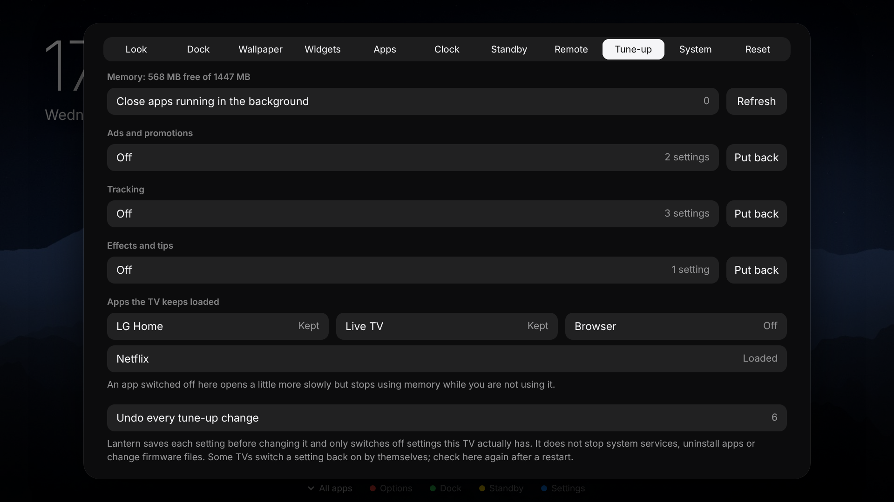

# Lantern

A customisable home screen for rooted LG webOS TVs, written for webOS 4.x (Chromium 53) and later.

I built Lantern as a single web app with no framework and no build step: one script, one stylesheet. It gives you a dock, a grid of apps, widgets, a standby mode, remote-button remapping and a reversible tune-up, and it can undo every change it makes to the TV.

> **Status: early release, tested on one TV.** I run Lantern on my own **LG 43LM6300PLA** (2019, webOS 4.10.2, rooted with Homebrew Channel), and most features work there. See [Tested on](#tested-on) for exactly what I have and have not confirmed. Other models may behave differently.

| Home | All apps (press Down) |
| --- | --- |
|  |  |

| Standby | Setup | Tune-up |
| --- | --- | --- |
|  |  |  |

The screenshots are from my desktop test, so the tiles show placeholder icons.

## Features

- **Step-by-step setup.** The first time it opens, Lantern walks through location, light or dark, wallpaper, dock, standby and the Home button. It can be run again from Settings, System.
- **Light and dark.** Automatic by sunrise and sunset where you are, always dark, or always light, with an option to go dark in dull weather. A different wallpaper can be used at night, and standby can go black with a dim clock at night.
- **Location.** Type your town, or let Lantern look it up from your internet address when you ask it to.
- **Calm home screen.** A picture background, a large clock with the date and weather, and a dock of your apps. Press Down (or the dock's last tile) and a full menu of every app and input opens over it; Up or Back closes it. A classic style with everything on screen is one setting away.
- **Dock.** Apps you pin come first, and the dock tops itself up with the apps you opened most recently (or use most) to a number you choose, five by default. App icons or wide cards in three sizes, at the bottom or the top, centred or left, with or without a glass panel.
- **Per-app options.** Rename an app, give it an icon from a web address, recolour its tile, move it along the dock or hide it.
- **Widgets.** Up to five: clock, weather, three-day forecast, calendar, world clock, countdown, note, photo and TV memory.
- **Wallpaper.** Nine bundled pictures for day and night, plain black and gradients, online photos, any picture address, or a picture from USB or TV storage.
- **Standby.** After a delay the dock and apps fade away. You choose what stays: clock, date, weather and your widgets, over the home wallpaper, the bundled pictures in turn, online photos in turn, or black.
- **TV inputs.** Live TV and HDMI tiles, with a live preview while one is selected.
- **Home button and remapping.** Make the Home button open Lantern, and remap other buttons: press the button, see what it does now, choose a new action, then confirm it works within 30 seconds or it is put back.
- **Instant Home.** Loads Lantern in the background after the TV starts, asks the TV to keep it in memory, and loads it again if the TV closes it, so the Home button resumes it instead of starting it cold. See [docs/WARM-START.md](docs/WARM-START.md).
- **Home app and start-up.** Make Lantern the TV's own Home app where the TV supports it, or map the Home button through LG Input Hook (one or the other, never both). "Start the TV on Lantern" adds it to the input list and makes it the input the TV starts on.
- **Tune-up.** Close apps running in the background, switch off the TV's ad, promotion and tracking settings, and stop apps being preloaded. Each original value is saved first.
- **System information.** Root status, Homebrew Channel and LG Input Hook status, model, webOS version, firmware, memory and IP address.
- **Restart when it matters.** If setup changed how the TV starts or opens Lantern (Home app, input, start-up, staying in memory), Lantern restarts the TV at the end so the changes take effect, with a 15 second countdown and a Later button.
- **Restore TV defaults.** One button undoes every change Lantern made outside its own folder.

## Tested on

I have tested Lantern on one TV, my own: **LG 43LM6300PLA**, webOS 4.10.2, rooted, Homebrew Channel installed.

| | What |
| --- | --- |
| Confirmed on my TV | The calm home screen with its dock and button hints; the earlier grid layout; app icons (loaded through the root symlink method, see the known issue below); weather; widgets, including the TV memory widget, which needs root; standby; the setup steps opening and running; Lantern set as the TV's Home app (`defaultApps.home`) with the Home key opening it; Lantern in the TV's input list, and the TV starting on Lantern after a full restart once it is the TV's last input. That start-up route is what my TV needed; other models may differ. |
| Measured on my TV (1.0.1) | My TV has 674 MB of memory. Sitting idle on the home screen, Lantern's process held about 44 MB, used 0% CPU, and did not grow over about 8 minutes. The TV's own preloading cost more than Lantern did: Netflix and YouTube were being kept loaded at about 97 MB and 77 MB, and switching those two preloads off raised available memory from about 131 MB to 264 MB. Graphics memory (CMA, 53 MB in total) was often under 1 MB free, which is why in 1.0.2 I removed the closed apps menu from the page and switched to 1280 x 720 wallpaper on TVs under 1 GB. I have not measured the effect of those 1.0.2 changes yet. |
| Working, but not written down | Most of the remaining features have worked on my TV, but I did not record which ones, so I list them as unconfirmed below. |
| Known issues on my TV | With widgets on, they vanished instead of fading when standby started (I reworked this in 1.0.1 and have not confirmed it). On a first install, app icons only appeared after Lantern was restarted; 1.0.1 reloads itself once when that happens, which I have not confirmed on the TV. Fading into standby was instant in 1.0.0 (fixed in 1.0.1, also unconfirmed). Opening Lantern cold (Home after it was closed, or waking from standby) shows LG's own loading cover for about 4 to 5 seconds, and LG Home has sometimes appeared as well. `noSplashOnLaunch` and `spinnerOnLaunch` in `appinfo.json` do not remove that cover. Instant Home is there to avoid cold starts; I have not confirmed it on the TV yet. |
| Not yet confirmed on a TV | The restart prompt after setup (1.0.3), including whether the restart command works on my TV. The reworked setup steps and the "Start the TV on Lantern" switch in 1.0.1, light and dark, day and night wallpapers, location lookup, Instant Home, the apps menu, button remapping and Tune-up. My automated tests cover these, but they run against a fake TV. |

## Requirements

- An LG TV running webOS 4.x or later, **rooted**, with [Homebrew Channel](https://github.com/webosbrew/webos-homebrew-channel) installed and showing "Root status: ok". Without root Lantern opens but cannot list apps.
- [LG Input Hook](https://repo.webosbrew.org/apps/org.webosbrew.inputhook/) installed from Homebrew Channel and opened once, for the Home button and remapping only.

## Install

Build the package (below) or download an `.ipk` from Releases, then install it with [webOS Dev Manager](https://github.com/webosbrew/dev-manager-desktop) or:

```sh
ares-install -d tv com.infixremix.lantern_1.0.3_all.ipk
```

## Remote

| Button | On the home screen |
| --- | --- |
| OK | Open the app. Hold OK for that app's options |
| Red | Options for the selected app |
| Green | Add the app to the dock, or take it out |
| Yellow | Start standby now |
| Blue | Settings |
| Down | Open the menu of all apps and inputs (Up or Back closes it) |
| Back | Return to the dock |

## Build and test

```sh
npm install
npm run package   # writes dist/com.infixremix.lantern_<version>_all.ipk
npm test          # needs Google Chrome; set CHROME=/path/to/chrome if it is not on PATH
```

`app/app.js` must stay ES5 so it runs on Chromium 53. `npm run check` fails if newer syntax slips in.

## How it works

See [docs/HOW-IT-WORKS.md](docs/HOW-IT-WORKS.md) for the full list of commands and files. In short:

- Root commands go through Homebrew Channel's `exec` service.
- Lantern writes only these things outside its own folder, and "Restore TV defaults" removes all of them:
  - its own entries in LG Input Hook's `/home/root/.config/lginputhook/keybinds.json` (the file is backed up once to `keybinds.json.lantern-bak`, and entries Lantern replaced are put back);
  - `/var/lib/webosbrew/init.d/55-lantern` and `/var/lib/webosbrew/lantern/`;
  - the "Lantern" entry in the TV's input list;
  - the TV's Home app setting and its start-up input (`lastInputApp`), if Lantern changed them (the previous values are put back);
  - the TV settings and preload choices changed in Tune-up.
- It never stops system services, uninstalls apps or touches firmware partitions.

If Lantern will not open, deleting `/var/lib/webosbrew/init.d/55-lantern` over SSH removes its start-up script.

## Known limits

- The TV shows its own loading cover whenever Lantern starts cold. Instant Home avoids cold starts while the TV is on, but the TV closes most apps when it goes to standby, so the first open after waking can still show the cover. See [docs/WARM-START.md](docs/WARM-START.md).
- Use one Home path: the TV's Home app setting or the LG Input Hook mapping. Lantern removes its Input Hook Home mapping when it becomes the TV's Home app.
- Remapping buttons depends on the LG Input Hook app. Hearth bundles the key hook itself.
- Location lookup by internet address is accurate to about a town and can be wrong.
- Online photos and weather need the TV to accept current security certificates, which some old firmware does not.
- On my TV the loading cover is started by LG's own cover app when Lantern is opened as an input, and LG Home still receives the Home key even with Lantern set as the Home app. Lantern cannot remove either without changing system files, which it does not do.
- There is no screen saver replacement and no theme packs.

## Credits

I wrote Lantern's code myself and it includes no code from these projects. They are where I learned the methods.

- **[Hearth](https://github.com/rudra-avatar/Hearth)** by rudra-avatar (MIT). My reference for what a webOS launcher should do: quiet mode, keeping the launcher in memory, drawing from saved data first, releasing the wallpaper in the background, and confirming a remapped button before keeping it. A [Hearth pull request](https://github.com/rudra-avatar/Hearth/pull/37) documents the Input Hook log format Lantern reads.
- **[LG Input Hook](https://github.com/Simon34545/lginputhook)** by Simon34545 (BSD-3-Clause). Lantern does not include it, but relies on it being installed and writes its `keybinds.json`.
- **[webOS Homebrew Project](https://www.webosbrew.org/)** and **[Homebrew Channel](https://github.com/webosbrew/webos-homebrew-channel)**. The root `exec` service and the `init.d` start-up folder.
- **[webos-debloat](https://gist.github.com/Hackiri/6030364bbcc9ae28e982c746d0d8aedc)** by Hackiri (MIT). The Luna calls for the preload list and for closing apps, and the list of ad, promotion and tracking setting names used by Tune-up.
- **[lginputhook-nomute](https://github.com/frankthecrank/lginputhook-nomute)**, **[webos-vibehack](https://github.com/YoyoKaraZ/webos-vibehack)** and **[home-plus](https://github.com/pbalazaar/home-plus)**. Details of the key file's actions, the Home key code and running a script from a key.
- **[LumiOS](https://github.com/sebastianov92/LumiOS)**. Launching with `keepAlive` so the launcher stays in memory.
- **[ZeaKyX's webOS notes](https://gist.github.com/ZeaKyX/d8d85c56e9e57ba7da95600af091dfb7)**. Embedding TV inputs in a web app and registering an app as an input.
- **[webos-custom-launcher](https://github.com/rudra-avatar/webos-custom-launcher)** and **[webos-home-launcher](https://github.com/udeshvirk/webos-home-launcher)**. The TV's Home app setting (`defaultApps.home`) and the report that webOS 4.10.2 supports it.
- **[Simple LG launcher](https://github.com/fardroid/Simple-LG-launcher)**. The finding that the TV closes apps at standby unless they are on its keep-alive list.
- **[SunCalc](https://github.com/mourner/suncalc)** by Vladimir Agafonkin (BSD-2-Clause). Lantern's sunrise and sunset maths uses the same published formulas.
- **[Open-Meteo](https://open-meteo.com/)** for weather and sunrise and sunset data (CC BY 4.0), **[ipapi.co](https://ipapi.co/)** and **[ipwho.is](https://ipwho.is/)** for location lookup, and **[Lorem Picsum](https://picsum.photos/)** for online photos.

I generated the nine bundled background pictures in `app/walls/` for this project, and they are covered by the same licence.

Lantern and I are not affiliated with LG. Rooting a TV and changing how it behaves is at your own risk.

## Licence

[MIT](LICENSE) © 2026 infixremix
